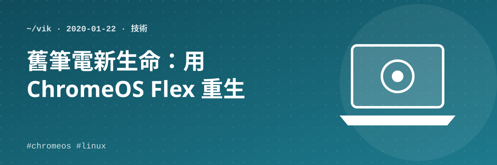

如果家裡有舊 NB，可以用以下方法安裝 ChromeOS。

> **2026-11 更新**：本文最初（2020 年）使用的是 Neverware 的 CloudReady。Neverware 在 2020 年底被 Google 收購，CloudReady 之後由 Google 官方的 **ChromeOS Flex** 取代，原本的 `cloudready-usb-maker.exe` 下載頁面也已停用。以下步驟已改寫為 ChromeOS Flex 的作法。

## 事前準備

- 一支 **8 GB 以上**的 USB 隨身碟（製作過程會**清除隨身碟內所有資料**）
- 一台可以執行 Chrome 瀏覽器的電腦（Windows、macOS、ChromeOS 皆可），用來製作開機碟
- 要安裝的舊筆電：建議 64 位元 Intel / AMD 處理器、4 GB 以上記憶體、16 GB 以上儲存空間，並能進入 BIOS / UEFI 選擇 USB 開機
- 可先到 Google 的 [ChromeOS Flex 認證機型清單](https://support.google.com/chromeosflex/answer/11513094?hl=zh-Hant) 查詢自己的機型，清單內的機型相容性較有保障；不在清單內的也多半能裝，只是部分硬體（如觸控板、網卡）可能無法正常運作

## 一、製作 USB 開機碟

1. 在 Chrome 瀏覽器開啟 **Chrome 線上應用程式商店**，搜尋並安裝「**Chromebook 還原公用程式**」（Chromebook Recovery Utility）擴充功能
2. 點選瀏覽器右上角的擴充功能圖示，開啟「Chromebook 還原公用程式」，按下「**開始使用**」
3. 選擇「**從清單中選取型號**」，並依序選擇：
   - **製造商**：`Google ChromeOS Flex`
   - **產品**：`ChromeOS Flex`
4. 按下「**繼續**」，插入 USB 隨身碟，於下拉選單中選擇該隨身碟，再按「**繼續**」
5. 按下「**立即建立**」，工具會自動下載 ChromeOS Flex 映像檔並寫入 USB，完成後會顯示「你的復原媒體已準備就緒」，即可移除隨身碟

## 二、開機與安裝

1. 將 USB 插入舊筆電後開機，按下開機選單鍵（依廠牌不同，常見為 `F12`、`F9`、`F2`、`Esc`），選擇從 USB 開機
   > 若找不到 USB 選項，請進 BIOS / UEFI 將 USB 開機排在前面；部分機型需先關閉「安全開機」（Secure Boot）。
2. 進入 ChromeOS Flex 歡迎畫面後，先選擇語言，接著會出現兩個選項：
   - **Install ChromeOS Flex**：直接安裝到硬碟
   - **Try it first**：先從 USB 試用，確認網卡、觸控板、音效等硬體都正常再安裝（建議先選這個）
3. 選擇安裝後，系統會提示**硬碟上的所有資料（包含原本的 Windows）都會被清除**，確認後開始安裝，約 10～20 分鐘
   > 若是先選「Try it first」，登入後可在右下角狀態列選單中執行 *Install ChromeOS Flex*。
4. 安裝完成後會自動關機，拔掉 USB 重新開機，改由硬碟開機，依畫面指示設定網路並登入 Google 帳號
   > 之前的安裝經驗：我的 NB 網卡找不到 Driver（懶得找），但補上一支 WiFi USB 網卡後也可以。
   > 初次設定需要連上網路才能登入 Google 帳號，若內建網卡無法使用，可準備一支 USB 無線網卡或 USB 有線網卡。

## 三、實例：Microsoft Surface Pro 5（2017）

以手邊的 Surface Pro 5 為例，它**不在** [ChromeOS Flex 認證機型清單](https://support.google.com/chromeosflex/answer/11513094?hl=zh-Hant) 中（清單內的 Microsoft 機型只有 Surface Go 2、Surface Go 3、Surface Laptop SE、Surface Pro 3），但規格（第 7 代 Intel Core、4 GB 以上記憶體、SSD）符合需求，仍然可以安裝，只是部分硬體功能不保證能用。

### 安裝前準備

- **備份資料**：安裝會清除整顆 SSD，原本的 Windows 也會一併移除
- **保留回到 Windows 的退路**：可先到 Microsoft 的 [Surface 復原映像下載](https://support.microsoft.com/zh-tw/surface-recovery-image) 頁面，輸入機身序號下載 Surface Pro 5 的復原映像，日後想改回 Windows 時使用
- **USB 孔只有一個**：開機碟會佔用唯一的 USB-A 孔，安裝時鍵盤、觸控板請使用 Type Cover；若還需要接滑鼠或 USB 網卡，請準備一個 USB Hub

### 從 USB 開機

1. 將 Surface 完全關機，插入 ChromeOS Flex 開機 USB
2. **按住「音量 −」鍵**，再按一下電源鍵，看到 Surface 標誌後放開音量鍵，即會從 USB 開機
3. 若無法從 USB 開機：關機後**按住「音量 +」鍵**再按電源鍵，進入 Surface UEFI 設定
   - 在「Boot configuration」將 USB Storage 移到最上方
   - 若仍無法開機，可在「Security」中將 Secure Boot 改為停用（Disabled）後再試

### 先試用，再決定是否安裝

開進 ChromeOS Flex 後，**強烈建議先選「Try it first」**，逐項確認下列功能：

| 項目 | 預期狀況 |
|---|---|
| 處理器、記憶體、SSD | 符合需求，可正常使用 |
| Type Cover 鍵盤與觸控板 | 通常可正常使用 |
| 觸控螢幕、Surface Pen | **很可能無法使用**（Surface 的觸控晶片需特殊驅動，ChromeOS Flex 未內建） |
| 前、後鏡頭 | **很可能無法使用** |
| Wi-Fi | 一般可用，偶有不穩定 |
| 音效、螢幕亮度、睡眠喚醒、電池 | 大致正常，續航力可能比 Windows 短 |

> 結論：若試用後發現觸控無法使用，而你主要是拿它當平板，建議保留 Windows；若主要是接上 Type Cover 當作輕薄筆電上網、看文件、跑 Linux，ChromeOS Flex 是讓老 Surface 繼續服役的好選擇。
> 以上狀況為依 Surface 系列在 Linux 上的一般經驗整理，實際結果以自己機器試用為準。

## 四、啟用 Linux 開發環境

ChromeOS Flex 同樣支援 Linux 開發環境（Crostini），可以像操作 Android 一樣在設定中開啟：

1. 開啟「**設定**」→「**關於 ChromeOS**」→「**開發人員**」
2. 在「**Linux 開發環境**」旁點選「**設定**」，依指示設定使用者名稱與磁碟大小後按「**安裝**」
3. 安裝完成後會出現「**終端機**」App，就可以使用 Google 包裝的 Debian Linux 環境

> 註：部分較舊的處理器（未支援虛擬化）可能無法啟用 Linux 開發環境。
