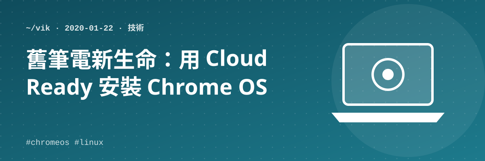

如果家裡有舊 NB，可以用以下方法安裝 Chrome OS。

## 一、製作 USB 開機碟

1. 下載 CloudReady（For personal, home use）版本的 Chrome OS 安裝工具：https://www.neverware.com/#get-cloudready
2. 點選 *Get The Free Version*，再點選 *Download USB Maker*，下載可製作 USB 開機碟的安裝工具（`cloudready-usb-maker.exe`）
3. 執行 `cloudready-usb-maker.exe` 開始製作開機 USB（基本上就是一直按 Next）

## 二、開機與安裝

1. USB 插入後開機，先選擇語系、設定網路
   > 之前的安裝經驗：我的 NB 網卡找不到 Driver（懶得找），但補上一支 WiFi USB 網卡後也可以。
   > 如果沒有網路，先跳過網路設定，後續再插上 WiFi 網卡也行。
2. 正式登入後，可以點選右下角功能，執行 *Install OS*。此時會開始將 Chrome OS 安裝到硬碟（約 20 分鐘）
3. 拔掉 USB 重新開機，改由硬碟開機。這時候可以像操作 Android 一般，於設定功能中將 Linux 安裝完成，這樣就可以使用 Google 包裝的 Linux 版本
