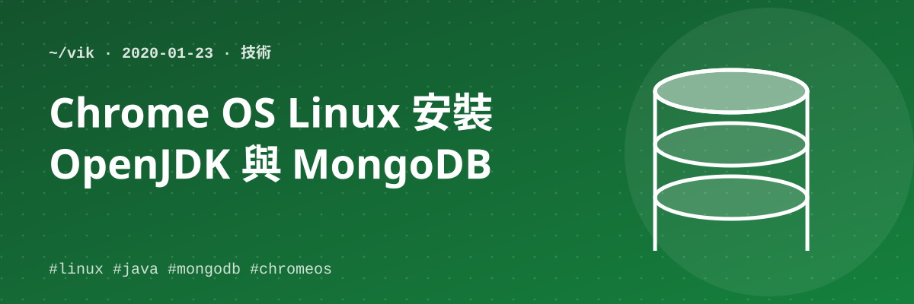

## 一、OpenJDK

```bash
sudo apt-get update
sudo apt-get upgrade
sudo apt-get install openjdk-8-jdk
```

## 二、MongoDB（Chrome OS 的 Linux）

主要安裝程序參考官方文件：https://docs.mongodb.com/manual/tutorial/install-mongodb-on-ubuntu/

```bash
apt-key adv --keyserver hkp://keyserver.ubuntu.com:80 --recv EA312927
echo "deb http://repo.mongodb.org/apt/ubuntu xenial/mongodb-org/4.2 multiverse" | sudo tee /etc/apt/sources.list.d/mongodb-org-4.2.list
apt-get update
apt-get install -y mongodb
```

> PS. 官方文件 Ubuntu 步驟是 `apt-get install -y mongodb`，但我安裝失敗，改成 `apt-get install -y mongo` 竟意外成功了。版本似乎是 3.2.11，但先能用再說。

啟動與管理服務：

```bash
sudo service mongodb start     # 啟動服務
sudo service mongodb stop      # 停止服務
sudo service mongo status      # 服務狀態
```

> PS. 官方文件寫的是 `sudo service mongod start`，但這裡必須用 `mongo`。

測試：執行 `mongo`，接著執行 `db`，如果有看到 `test`，就成功了。

**QA**：到底 Chrome OS 是基於哪種 Linux？官方文件只針對主流 Linux 提供安裝程序，所以裝起來版本不太一樣。後來檢查版本，看來是 3.12 版。

## 三、MongoDB（Ubuntu）

完全依照官方文件即可，一模一樣。
