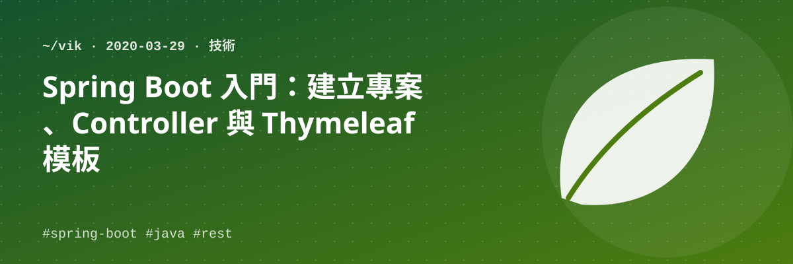

## 一、建立專案

1. 開啟 Eclipse
2. Create new project → *Spring Starter Project*

   | 欄位 | 值 |
   | --- | --- |
   | Service URL | default |
   | Name | kochaWeb |
   | Location | （本機路徑） |
   | Group | com.vik |
   | Artifact | kochaWeb（同 Name） |
   | Package | com.vik |

3. 選擇元件：Web、NoSQL-MongoDB、Spring for Apache Kafka…
4. Finish

## 二、執行方式

1. Eclipse 中直接執行專案
2. DOS：`D:\> mvn spring-boot:run`
3. 打包成 jar：
   - `D:\> mvn package`
   - `java -jar xxx.jar`

## 三、Browser 測試

http://localhost:8080 — 會出現錯誤，因為 Spring Boot 尚未指定 Controller。

## 四、新增 Controller

新增後重新測試 http://localhost:8080/kocha/v1.0.0/sayHello

```java
package com.vik.kocha;

import org.springframework.web.bind.annotation.GetMapping;
import org.springframework.web.bind.annotation.RequestMapping;
import org.springframework.web.bind.annotation.RestController;

@RestController
@RequestMapping("/kocha/v1.0.0")
public class KochaController {

  @GetMapping("/sayHello")
  public String hello() {
    return "Hello Spring Boot!!";
  }

  @GetMapping("/dbCount")
  public String count() {
    return "20";
  }
}
```

## 五、HTML 模板

如果要顯示頁面，要建立一個可以對應的模板：

1. `@RestController` 改為 `@Controller`
2. `pom.xml` 新增：

   ```xml
   <dependency>
     <groupId>org.springframework.boot</groupId>
     <artifactId>spring-boot-starter-thymeleaf</artifactId>
   </dependency>
   ```

3. 於 `resources/templates` 中新增一個 HTML 頁面模板 `kochas.html`
4. 新增 method：

   ```java
   @GetMapping("/kochas")
   public Object getAll() {
     return "kochas";  // 這裡必須和 html 檔名相同
   }
   ```

## 參考資料

- 理解 RESTful 架構（阮一峰）：https://www.ruanyifeng.com/blog/2011/09/restful.html
- RESTful API 設計指南（阮一峰）：http://www.ruanyifeng.com/blog/2014/05/restful_api.html
