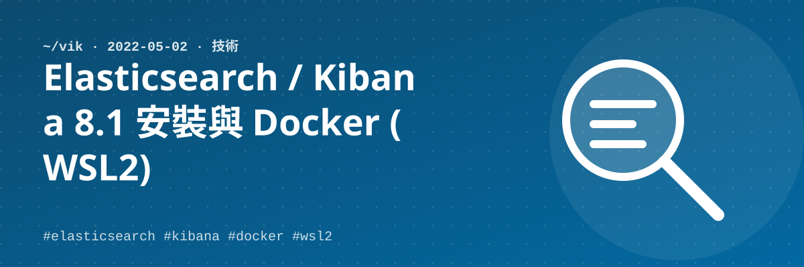

## 安裝 Elasticsearch（Ubuntu）

官方文件：https://www.elastic.co/guide/en/elasticsearch/reference/8.1/deb.html#deb-repo

> 以下動作均在 Acer NB 實驗過。

```bash
wget -qO - https://artifacts.elastic.co/GPG-KEY-elasticsearch | sudo gpg --dearmor -o /usr/share/keyrings/elasticsearch-keyring.gpg
sudo apt-get install apt-transport-https
echo "deb [signed-by=/usr/share/keyrings/elasticsearch-keyring.gpg] https://artifacts.elastic.co/packages/8.x/apt stable main" | sudo tee /etc/apt/sources.list.d/elastic-8.x.list
sudo apt-get update && sudo apt-get install elasticsearch
```

裝完後會產生 `elastic` 這個預設帳號的密碼，**要存起來**。

```bash
sudo systemctl enable elasticsearch.service   # 設為開機啟動
sudo systemctl start elasticsearch.service    # 啟動服務
sudo curl --cacert /etc/elasticsearch/certs/http_ca.crt -u elastic https://localhost:9200   # 檢查服務
```

如果用一般使用者安裝，會看不到 `certs` 目錄，故加上 `sudo`。

## 移除 Elasticsearch

遇過的狀況：本來安裝 ES 7.1x，後來移除 ES7 改安裝 ES8，但 ES8 無法啟動。查錯誤訊息是 ES7 的資料無法 join 進 ES8，因此要嘛 upgrade ES7 資料，不然就把 ES7 移除乾淨。

```bash
cat /etc/os-release                              # 檢查版本
curl http://localhost:9200/_cluster/health?pretty # 確認 ES 是否執行
jps | grep elasticsearch                         # 確認是否有 ES 的 JVM
ps -ef | grep elastic
sudo apt remove elasticsearch                    # 移除 ES
sudo apt --purge autoremove elasticsearch        # 移除設定檔
sudo rm -rf /etc/elasticsearch                   # 移除安裝資料
sudo rm -rf /var/lib/elasticsearch/              # 移除安裝資料
```

## 安裝 Kibana

官方文件：https://www.elastic.co/guide/en/kibana/8.1/deb.html#deb-repo

```bash
wget -qO - https://artifacts.elastic.co/GPG-KEY-elasticsearch | sudo gpg --dearmor -o /usr/share/keyrings/elasticsearch-keyring.gpg
sudo apt-get install apt-transport-https
echo "deb [signed-by=/usr/share/keyrings/elasticsearch-keyring.gpg] https://artifacts.elastic.co/packages/8.x/apt stable main" | sudo tee /etc/apt/sources.list.d/elastic-8.x.list
sudo apt-get update && sudo apt-get install kibana
```

```bash
/usr/share/elasticsearch/bin/elasticsearch-create-enrollment-token -s kibana   # 產出 Kibana token
sudo /bin/systemctl enable kibana.service
sudo systemctl start kibana.service
```

1. 開啟 http://localhost:5601 ，並輸入上面產出的 token
2. 執行 `/usr/share/kibana/bin/kibana-verification-code` ==> 產生六碼驗證碼
3. 回到網站輸入六碼驗證碼，結束
4. 使用 `elastic` / 安裝時產生的密碼登入

---

## Docker sample（For WSL2）

微軟預設安裝會失敗，要用以下方式安裝：

```bash
curl -fsSL https://get.docker.com -o get-docker.sh
sudo sh get-docker.sh
sudo service docker start
```
