## 前言

久仰新北微笑山道中「皇帝殿步道」的大名，過去總是在網路上看到關於這裡稜線驚險、充滿攀爬挑戰的描述。這次終於親自前往，體驗這條北部三大岩場之一的經典路線。

## 交通與起點

出發當天早上約七點半抵達登山口。考量到這次是開車前往，我將車輛停放在石碇老街省道旁、往牌坊一彎進來的路邊（剛好有個公車停靠站）。從這裡步行至登山口約 1.6 公里，雖然有一段距離，但停車相當方便，也能趁機熱身。

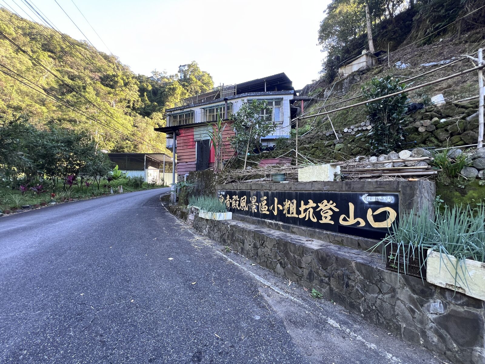

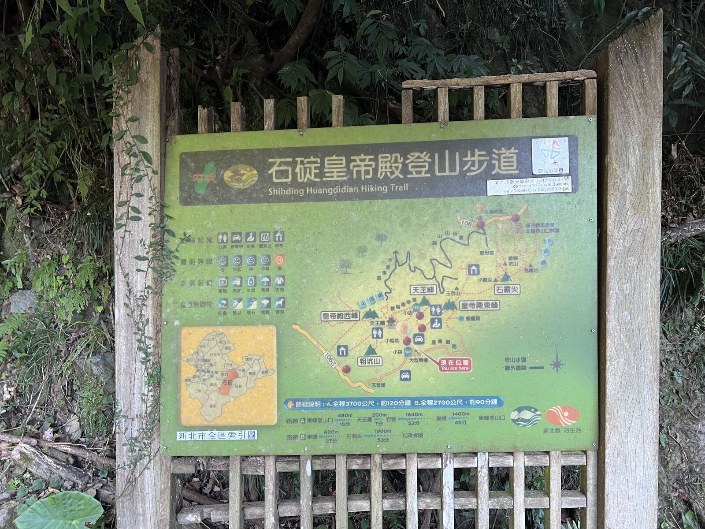

## 路線規劃：經典大O型縱走

今天選擇的是大眾走的完整大O型路線，星散佈於東西峰各處：

1. **起登**：從皇帝殿風景區登山口出發，往東峰入口上行。
2. **第一階段**：先取得東峰的第一顆星。
3. **第二階段**：往左折返往西峰方向，途中取得兩顆星。
4. **第三階段**：原路折返往東峰方向，取得剩下的三顆星。
5. **返程**：下山時順道拿下最後一顆星。

這種環狀設計（A去A回）對我們開車族非常友善，省去了需要從其他出口走回原處牽車的麻煩。

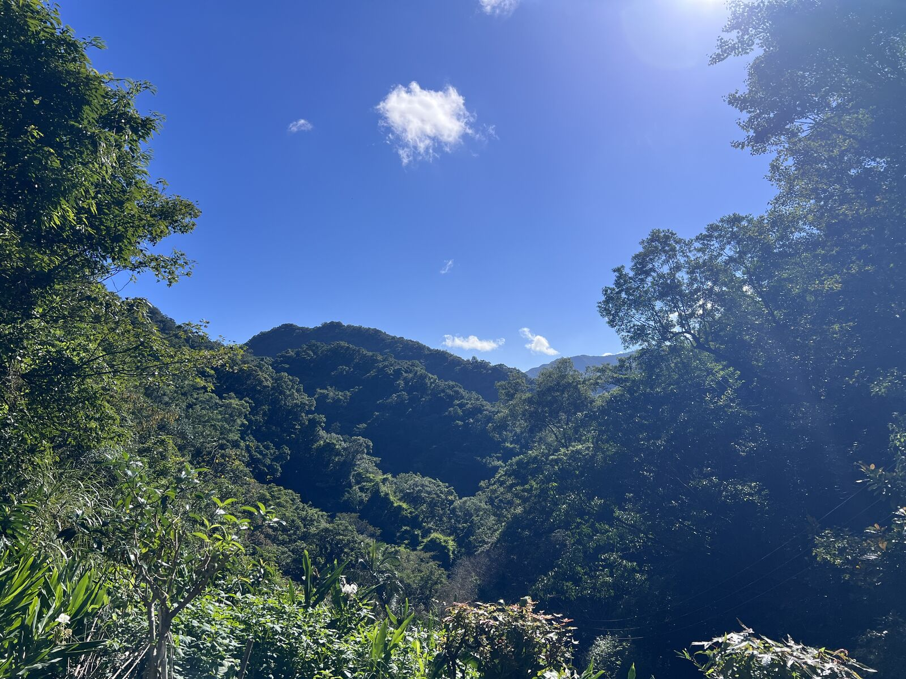

## 登山心得與挑戰

雖然在網路上看到的評價多數強調其「驚險」與「刺激」，但實際走過一遭後，我的感受是「刺激但難度還好」。整體的攀爬過程（特別是攀爬繩梯的路段）非常有趣，走走停停，也遇到了許多熱情的山友。在攀爬繩梯時大家互相幫忙、在休息點寒暄分享經驗，是登山過程中最迷人的人情味之一。

### 皇帝殿西峰

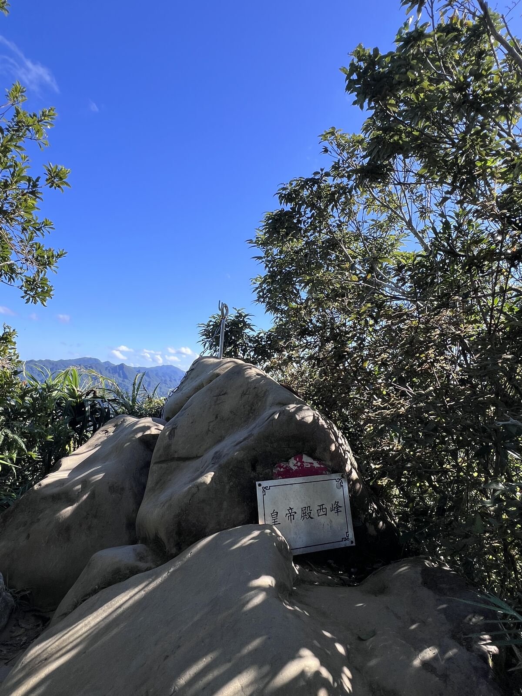

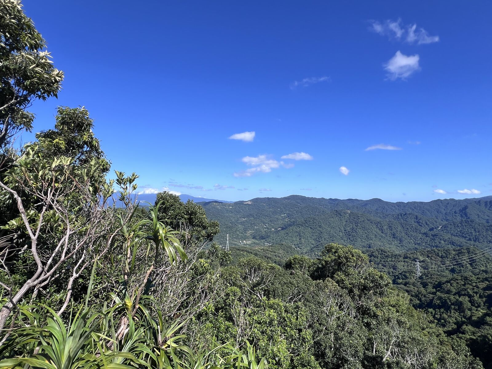

### 稜線攀爬

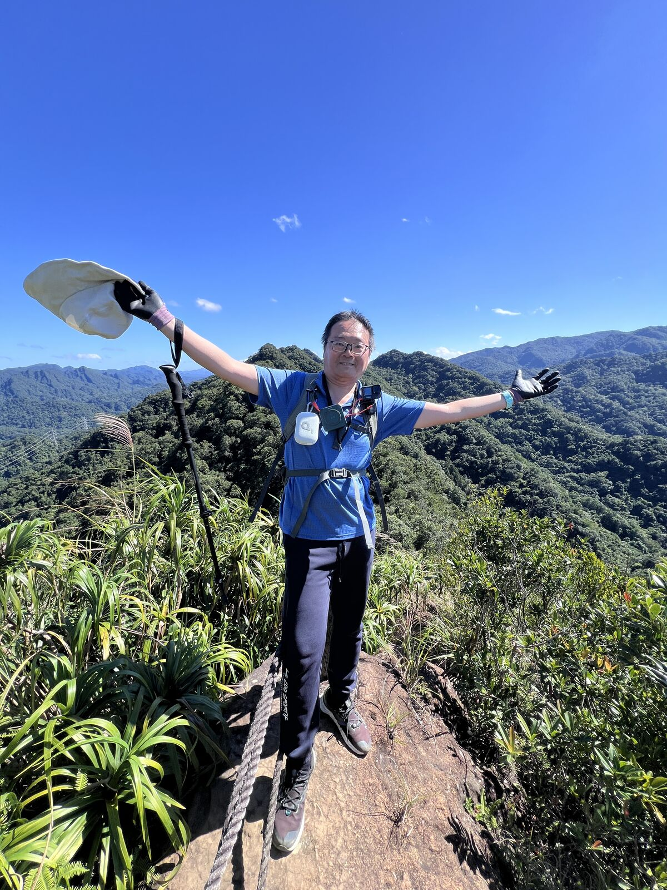

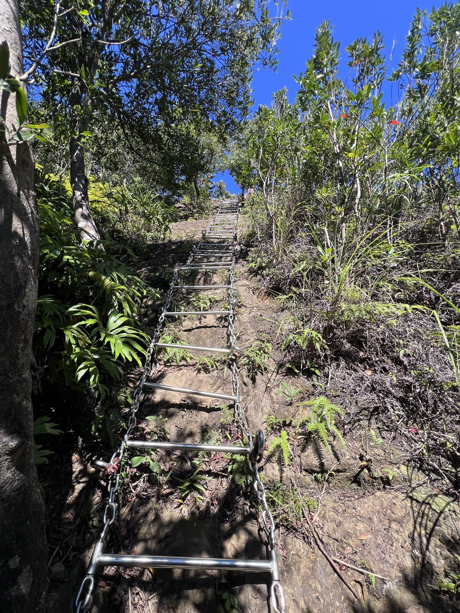

<video controls preload="metadata" src="mp4/IMG_0790.mp4"></video>

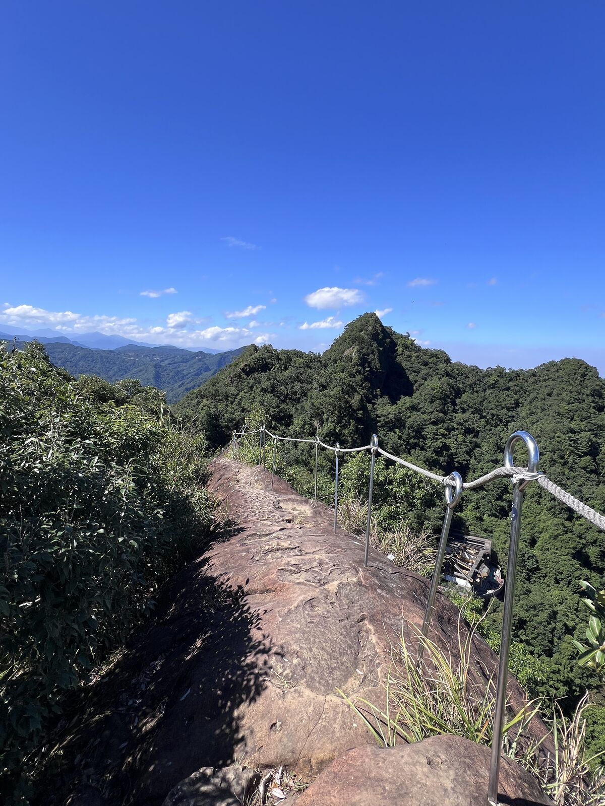

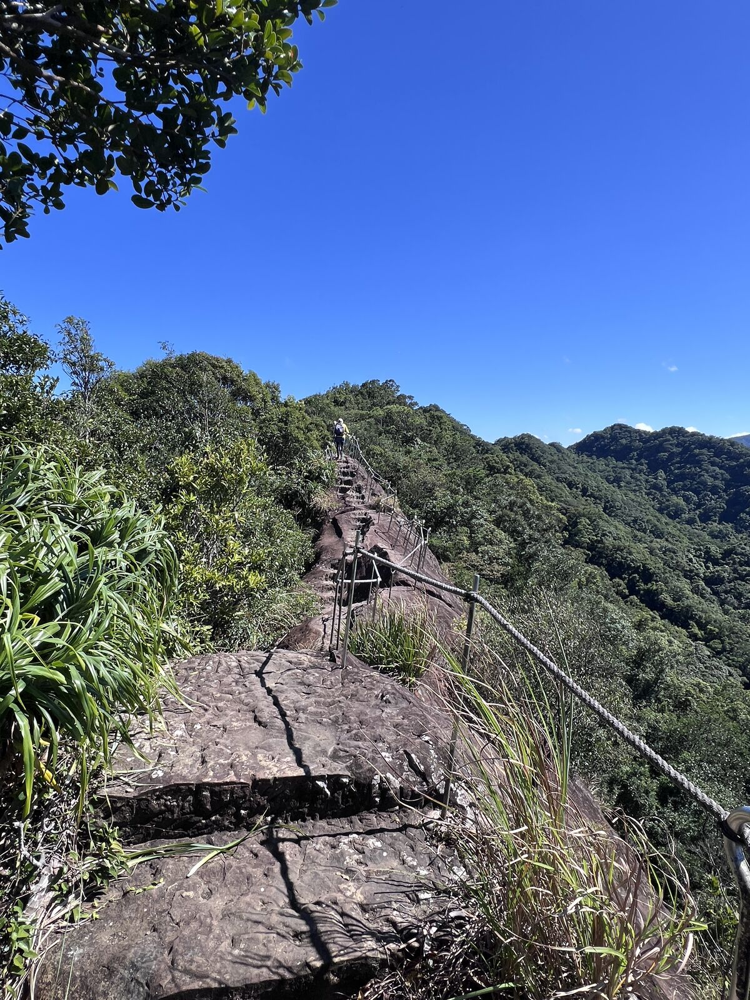

<video controls preload="metadata" src="mp4/IMG_0793.mp4"></video>

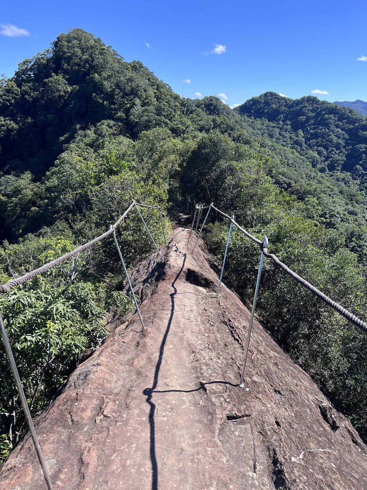

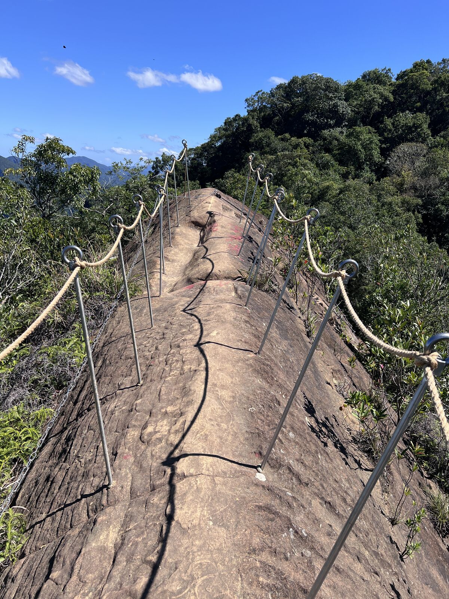

### 天王峰

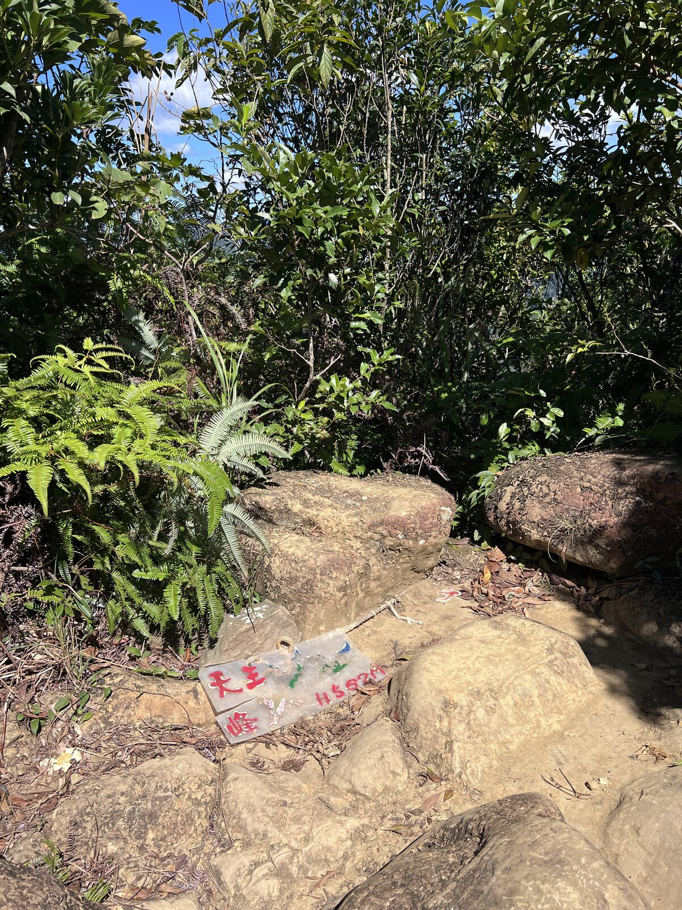

### 皇帝殿東峰

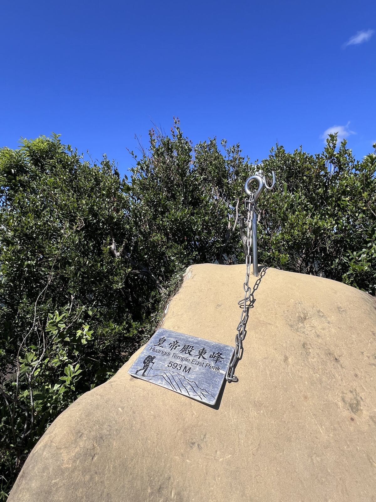

<video controls preload="metadata" src="mp4/IMG_0806.mp4"></video>

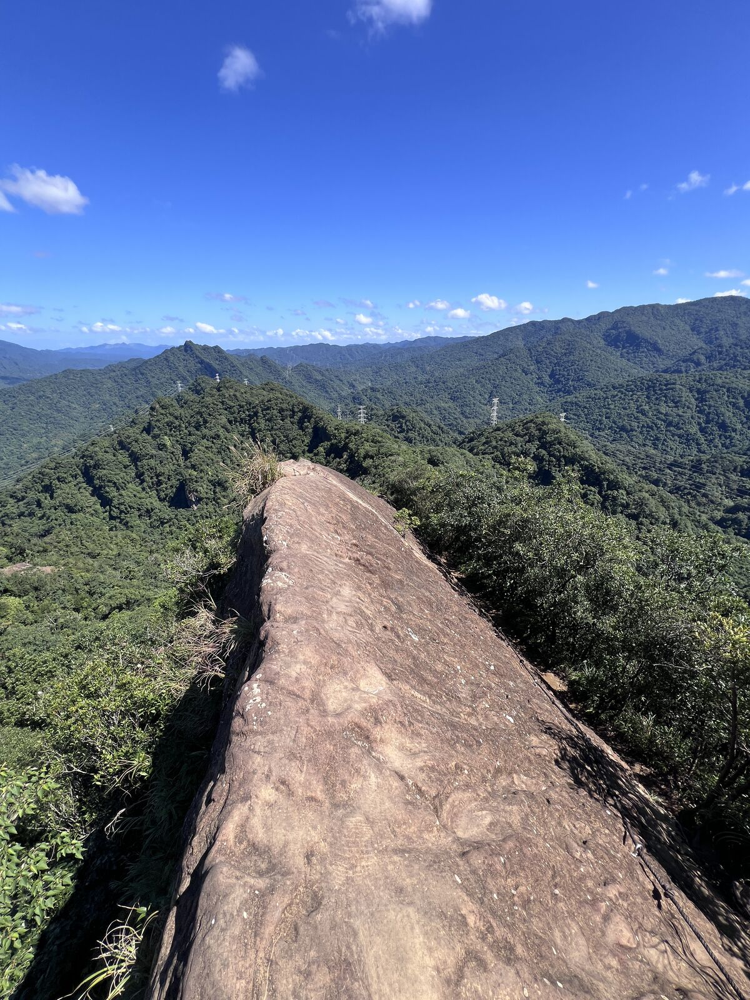

這趟行程大約耗時六個多小時（從早上快八點出發，到下午兩點多結束），體能消耗相當大，風景也非常完整且壯觀。

## 結語

皇帝殿大O型路線是一條兼具問題與美景的步道，對於想嘗試攀爬地形的人來說是非常好的入門岩場。這次的O型路線規劃讓整體交通安排更加順暢，是一趟相當充實且值得回味的登山體驗。
