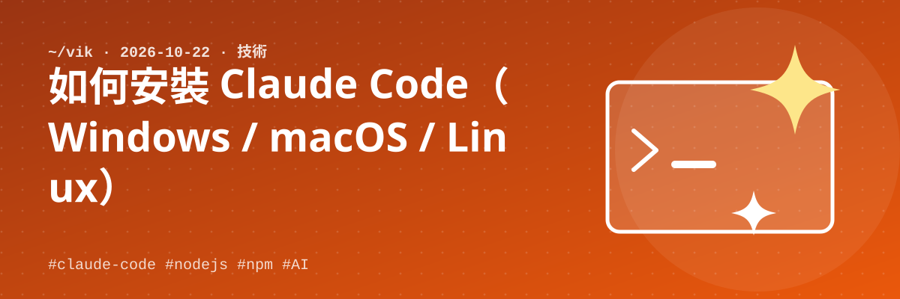

朋友問我怎麼安裝 Claude Code，我才發現當初裝的時候沒有把步驟記下來，所以補寫這篇。流程只有三步，**只有第 1 步（安裝 Node.js）會因作業系統而不同**。

## 1. 安裝 Node.js

安裝 LTS 最新版即可。選你的作業系統：

### Windows

1. 到 https://nodejs.org 下載 LTS 版本並安裝（一直按 Next 即可）
2. 開啟 PowerShell 確認安裝成功：

```powershell
node -v
npm -v
```

### macOS

方法 A：到 https://nodejs.org 下載 LTS 的 `.pkg` 安裝檔，依畫面安裝。

方法 B：已經有 Homebrew 的話，一行搞定：

```bash
brew install node
```

開啟「終端機」確認：

```bash
node -v
npm -v
```

### Linux

Ubuntu / Debian 內建套件庫的 Node.js 版本常常偏舊，我建議用 **nvm**（Node 版本管理工具）安裝，這樣可以直接取得 LTS 最新版，而且之後 `npm install -g` 不需要 `sudo`：

```bash
# 安裝 nvm（版本號請以 https://github.com/nvm-sh/nvm 上的最新說明為準）
curl -o- https://raw.githubusercontent.com/nvm-sh/nvm/v0.40.1/install.sh | bash

# 關掉終端機重新開啟（或執行 source ~/.bashrc），再安裝 LTS 最新版
nvm install --lts

node -v
npm -v
```

> 如果直接用系統套件安裝（例如 `sudo apt install nodejs npm`），之後執行 `npm install -g` 可能遇到 `EACCES` 權限錯誤。不要用 `sudo` 硬裝，改用上面的 nvm 比較乾淨。

兩個指令都能顯示版本號，就表示 Node.js 安裝完成。

## 2. 使用 npm 安裝 Claude Code

三個作業系統指令相同：

```bash
npm install -g @anthropic-ai/claude-code
```

安裝完成後確認：

```bash
claude --version
```

> 官方近來也提供不需要 Node.js 的安裝方式，細節請以官方文件為準：https://docs.claude.com/en/docs/claude-code/overview
>
> Windows 的部分環境需要另外安裝 Git for Windows，或改在 WSL 裡使用。如果安裝後執行有問題，可以先檢查這一點。

## 3. 試驗

### (1) 新增目錄，並在目錄中執行 claude

```bash
mkdir my-first-claude
cd my-first-claude
claude
```

第一次執行會要求登入，依畫面指示用你的 Claude 帳號完成授權即可。登入後就會進入互動畫面。

#### Linux 沒有瀏覽器時怎麼認證？

Windows 和 macOS 通常會自動跳出瀏覽器完成授權，但 Linux（特別是 SSH 連線的伺服器）沒有瀏覽器，可以這樣做：

**方法一：用另一台有瀏覽器的裝置完成授權（最常用）**

1. 在 Linux 執行 `claude`，選擇用 Claude 帳號登入
2. 終端機會顯示**一串登入網址**
3. 把網址複製到**自己電腦或手機的瀏覽器**開啟，登入並同意授權
4. 網頁會給一組**授權碼**，貼回 Linux 的終端機，按 Enter 即可

授權碼是一次性的，貼上時要完整，也不要截圖或分享給別人。

**方法二：改用 API Key**

如果用的是 Anthropic Console 的 API 計費，而不是訂閱帳號，可以不走瀏覽器登入，直接設定環境變數：

```bash
export ANTHROPIC_API_KEY="你的 API Key"
claude
```

要永久生效，把這行加進 `~/.bashrc`。API Key 等同密碼，不要貼到公開的地方，也不要放進會 push 到 GitHub 的檔案。

**方法三：長效 token**

好像有 `claude setup-token` 指令，可以產生長效的授權 token，適合伺服器或自動化使用。這部分我沒有實際用過，請以 `claude --help` 或官方文件為準。

> 以上認證流程是依印象整理，我尚未在無瀏覽器的 Linux 上完整實測，實際畫面與步驟請以官方文件為準。

> 建議每次都先建立一個空的資料夾再啟動，因為 Claude Code 會在目前資料夾內讀寫檔案，不要在重要的資料夾裡亂試。

### (2) 請它幫我產生一個個人網頁

在互動畫面直接用中文輸入：

```text
請幫我產生一個個人網頁
```

Claude Code 會規劃並建立檔案（例如 `index.html`），過程中會詢問是否允許建立或修改檔案，確認後就會在資料夾裡看到成果。直接用瀏覽器開啟 `index.html` 就能看到結果。

之後可以繼續用對話調整，例如「改成深色風格」「加上我的自我介紹」，不用自己寫程式。

## 小結

| 步驟 | Windows | macOS | Linux |
| --- | --- | --- | --- |
| 安裝 Node.js | 官網安裝檔 | 官網 `.pkg` 或 `brew install node` | `nvm install --lts` |
| 確認 | `node -v` | `node -v` | `node -v` |
| 安裝 Claude Code | `npm install -g @anthropic-ai/claude-code` | 同左 | 同左 |
| 啟動 | 進入資料夾後執行 `claude` | 同左 | 同左 |
