## 前言

【天上山系】的烘爐地土地公段，是一條 **A 點 A 回、環繞一圈**的登山路線。可以選擇從南勢角進、外南勢角山出，也可以反過來走；沿途還能順便採集**南勢角山小百岳**。

這條路號稱是新北微笑山線的第二難路線，走完的感想是：**路況很好，還算好走**，就是路途比較遙遠。

## 交通方式

起點在南勢角站附近，有兩種到達方式：

1. **捷運**：搭捷運到南勢角站，再步行到登山口。
2. **開車**：開車到南勢角站附近停車，再步行到登山口。

### 這次的選擇：開車

我選擇開車前往。山路全程約 **12 公里**，預估至少要走 **5 小時**，所以把車停在單日上限 230 元的停車場（每小時 60 元），不用擔心超時費用一直累積：

- [Times 中和興南路二段停車場](https://www.google.com.tw/maps/place/Times+%E4%B8%AD%E5%92%8C%E8%88%88%E5%8D%97%E8%B7%AF%E4%BA%8C%E6%AE%B5%E5%81%9C%E8%BB%8A%E5%A0%B4/@24.9767872,121.5195905,14z/data=!4m6!3m5!1s0x3468035509b9da05:0xd7073cd66ac45a0a!8m2!3d24.9852862!4d121.5063394!16s%2Fg%2F11swn6wr_g?entry=ttu&g_ep=EgoyMDI2MTAyOC4wIKXMDSoASAFQAw%3D%3D)

| 項目 | 內容 |
| --- | --- |
| 路線型態 | A 點 A 回，環狀 |
| 山路距離 | 約 12 公里 |
| 預估時間 | 至少 5 小時 |
| 小百岳 | 南勢角山 |
| 停車場 | Times 中和興南路二段停車場，每小時 60 元，單日最多 230 元 |

## 路線紀錄

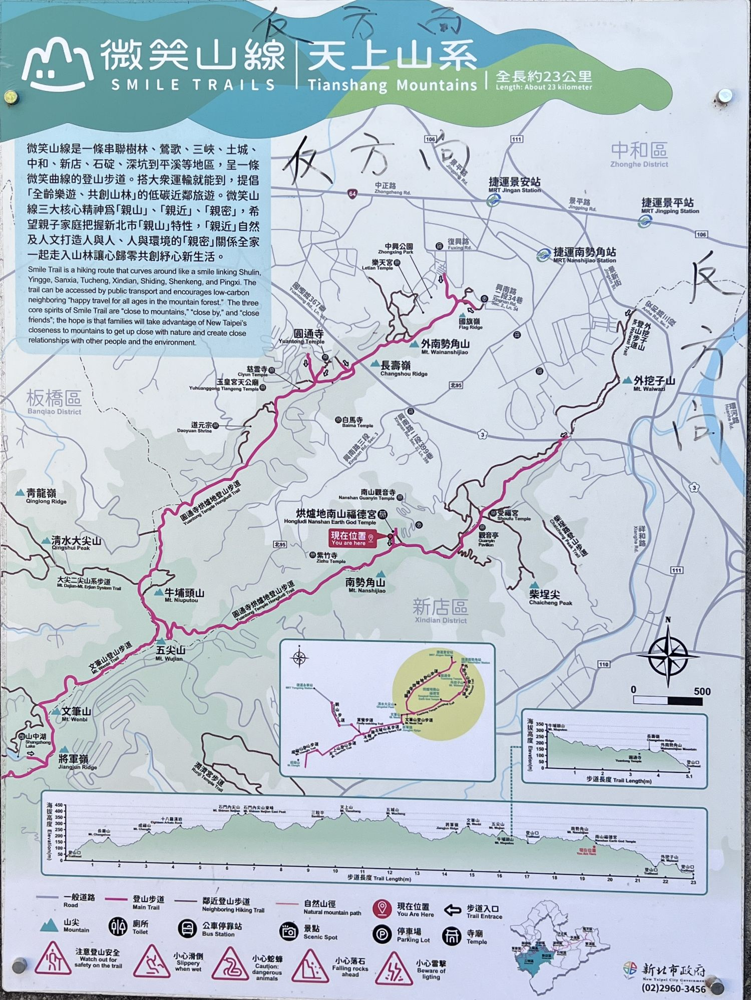

路線影片：

<video controls preload="metadata" src="mp4/PDML1002.MP4"></video>

### 1. 走向登山口

從南勢角站附近往上走到登山口約 **1.7 公里**，最後兩三百公尺挺陡的，走到時已經有點喘了。

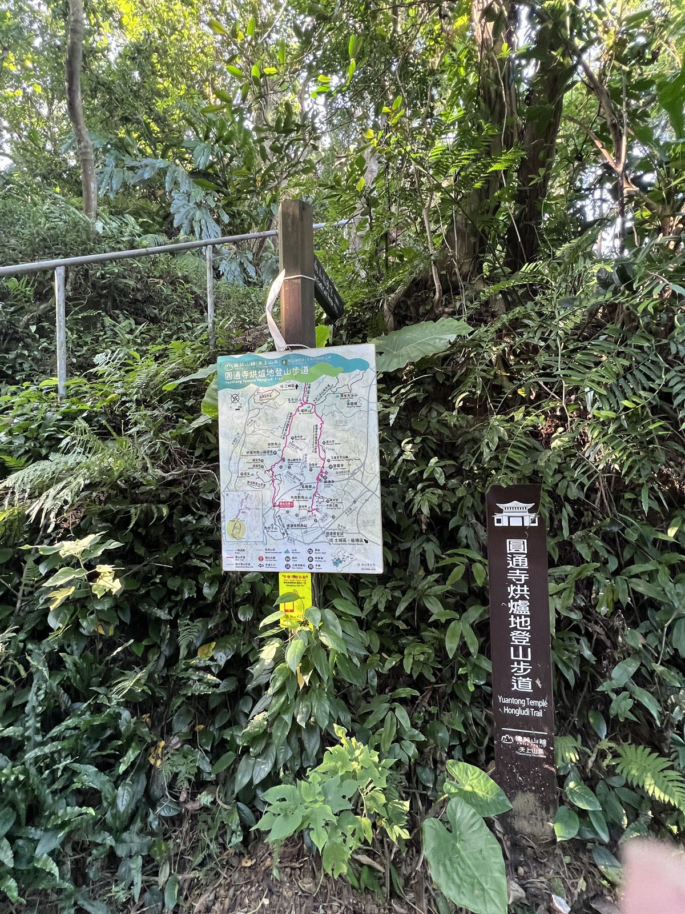

### 2. 原始步道

開始攀爬時，一開始是一段原始步道，還算好走，很快就走到稜線。

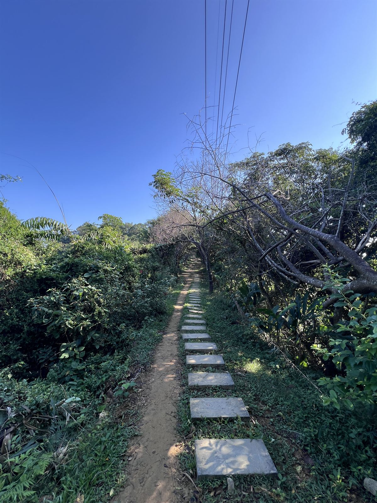

### 3. 第一、二顆星星與烘爐地土地公廟

上稜線沒多久就踩到第一顆星星，接著遠遠看到烘爐地土地公廟。上次來已經是 26 年前了。

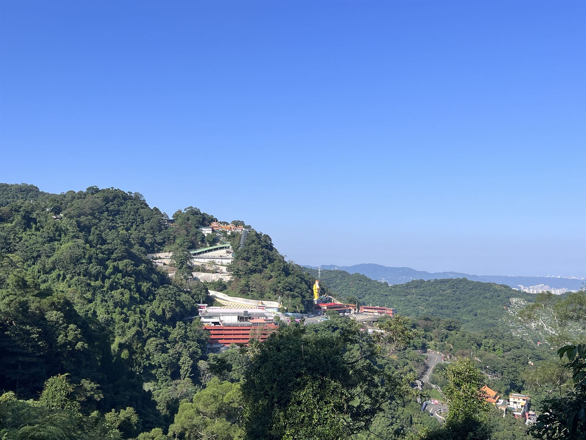

因為第二顆星星就在土地公廟旁，所以主幹道走到一半又彎進土地公廟，採星星、上廁所，順便休息一下。

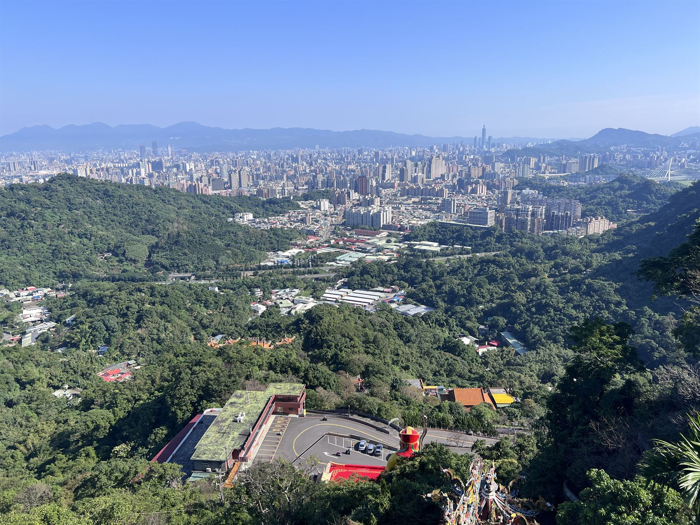

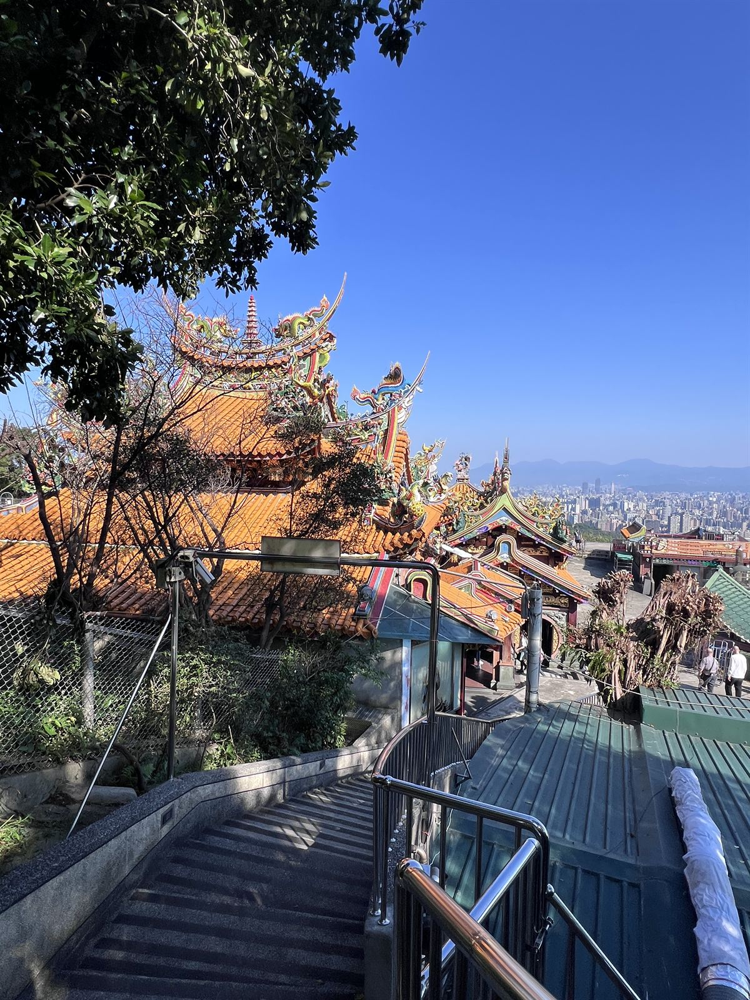

### 4. 南勢角山三角點

離開土地公廟回到主幹道，接著往右走，很快就到了南勢角山三角點。這也是一座**小百岳**，也是第三顆星星。

.JPG>)

途中經過小玉山：

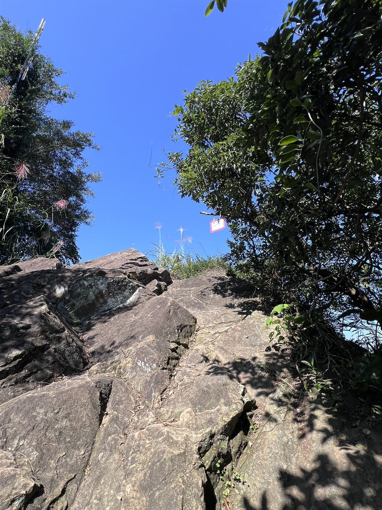

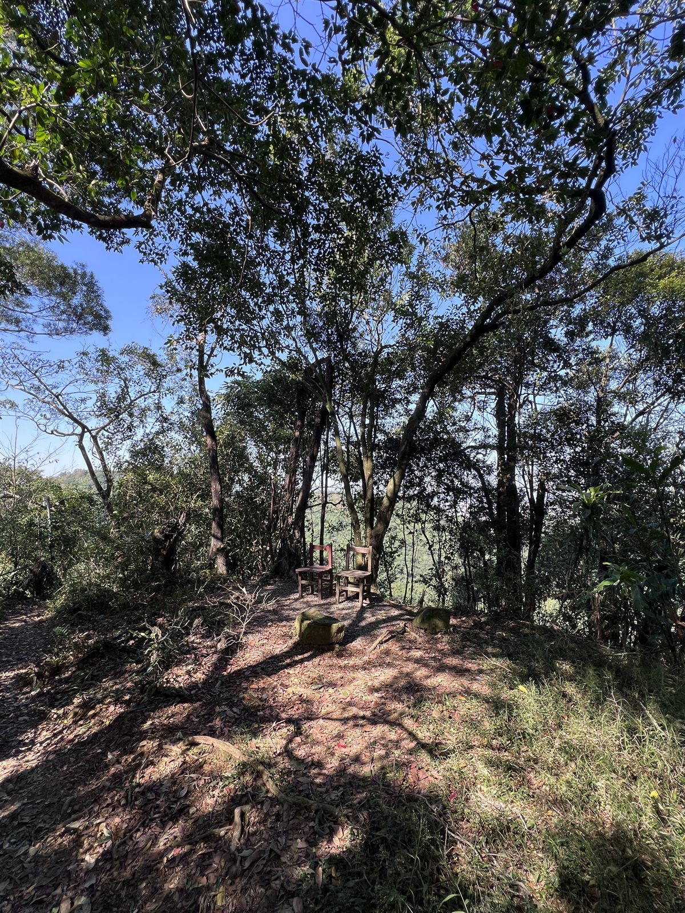

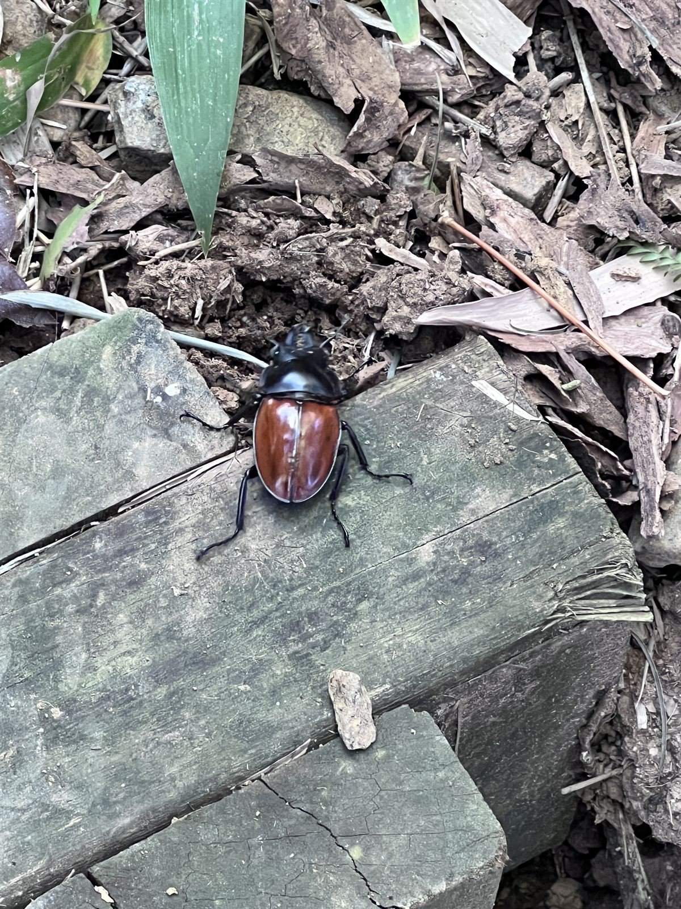

### 5. 三清宮到五尖山

繼續往前到了三清宮，這裡路線不是很清楚，繼續往前走就到了**五尖山三角點**。到這裡已經走了約一半路程，花了約 **2 小時 30 分鐘**。

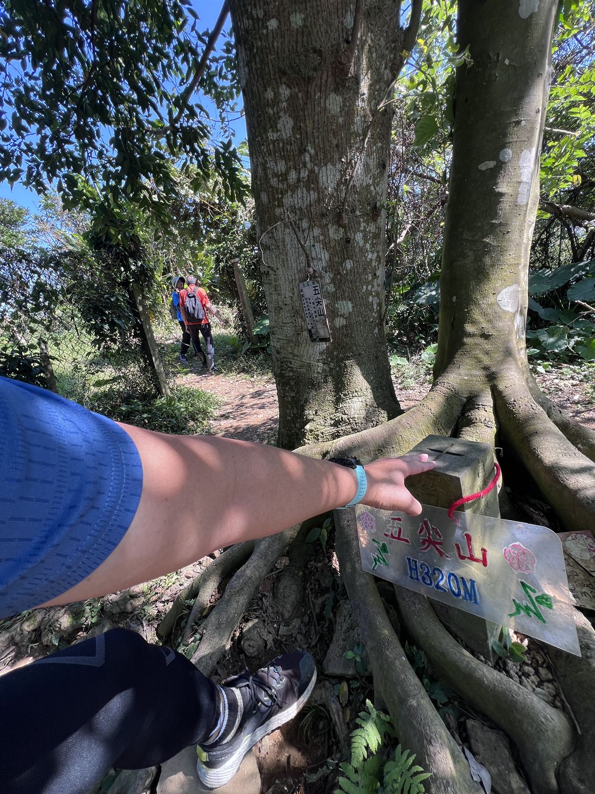

### 6. 回程：玉皇宮

再往下走就是回程了，先經過玉皇宮，在這裡休息一下。

### 7. 長壽嶺與外南勢角山

接著一路往長壽嶺三角點前進，最後經過外南勢角山。下山後直接繞過去牽車，結束今天的行程。

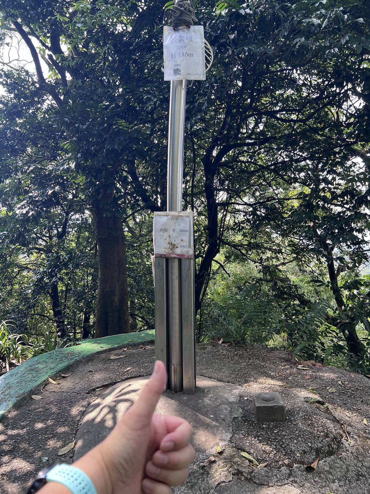

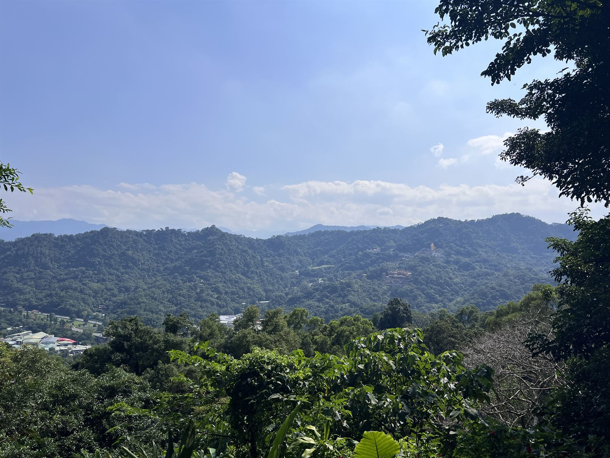

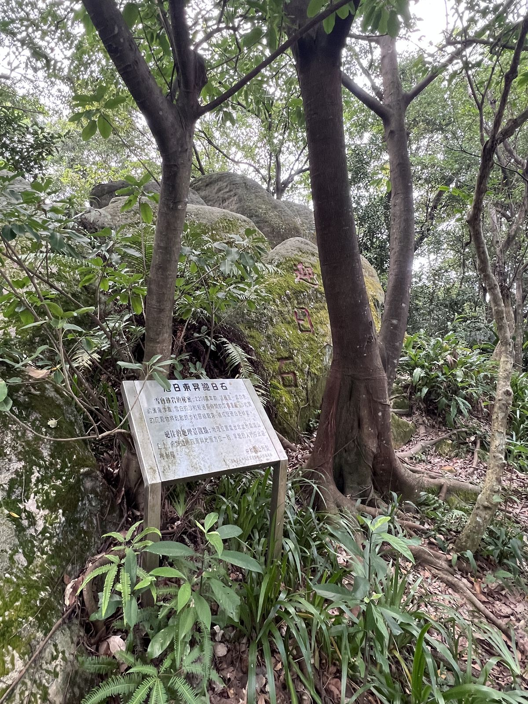

## 心得：路況好走，考驗在距離

這條路被稱為新北微笑山線的第二難路線，實際走下來，步道路況好走，主要的考驗是路途較遠，全程 12 公里走起來的感覺，和台北大縱走第六段（中華科技大學往捷運麟光站）有點相似。

依據官方標示，整段14條路線中，較具難度的三條路線為 [烘爐地「中」](https://hiking.biji.co/index.php?q=trail&act=detail&id=2077)、[皇帝殿「低中」](https://hiking.biji.co/index.php?q=trail&act=detail&id=2088)、[筆架連峰「中高」](https://hiking.biji.co/index.php?q=trail&act=detail&id=2087)，繼上次完成**皇帝殿**和這次的**烘爐地**兩段路線後，我應該可以去挑戰**筆架連峰**了，筆架連峰難度高，路況與體力都得更用心準備，不過沒有親自走一遍就不會知道，所以，走了再說。

## 新添裝備：SNUG 壓縮褲

今天全程穿著新裝備 SNUG 壓縮褲，很緊但很透氣不會黏踢踢的，聽說穿上後可節省 15% 的體力，藉由壓縮褲固定大腿肌肉不亂晃，可有效減少不必要的能量損耗，而且不會鐵腿。

先前買了不穿，是因為褲子穿起來很緊很難穿上來，但為了下次筆架連峰挑戰，今天先穿出來試試，走了一天還行，但真的很緊就是了。

## 參考資訊

- [[詹姆士的健行筆記] [新北中和] 捷運南勢角站出發！微笑山線 烘爐地土地公段 | 走訪光明頂、南勢角山、五尖山、外南勢角山（詹姆士的健行筆記）](https://www.youtube.com/watch?v=NZPbg3hma_4&list=PLIT-tOp32gTE&index=16)
- [[雲行] 圓通寺烘爐地登山步道｜來寺廟參拜？還是爬山健行？【臺灣小百岳】【微笑山線】](https://www.youtube.com/watch?v=5TNNuXGfF2c&list=PLIT-tOp32gTE&index=12)
